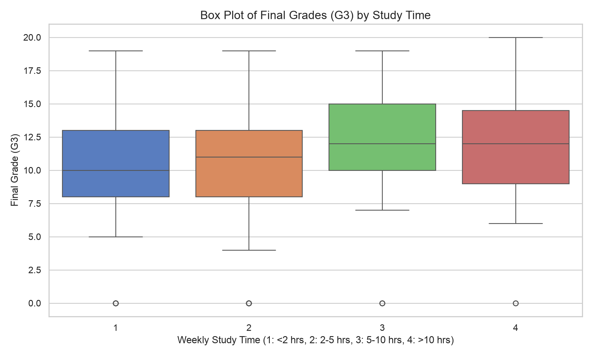
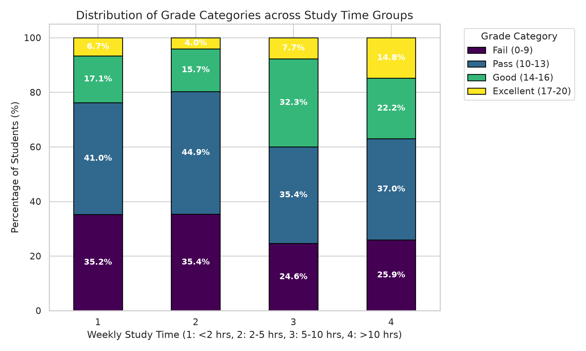

# Student Academic Performance Analysis

## Overview

This project was developed for **CS 2410 — Fundamentals of Data Science** at California State Polytechnic University, Pomona.

Our goal is to investigate the relationship between students' weekly study time and their final mathematics grades using real-world educational data.

**Research Question:** Is weekly study time associated with students' final mathematics grades?

We use Python to clean, analyze, and visualize student performance data.

## Dataset

The project uses the **Student Performance Dataset** from the UCI Machine Learning Repository.

Source: https://archive.ics.uci.edu/dataset/320/student+performance

We analyze the mathematics dataset (`student-mat.csv`), which contains:

- **395 student records**
- **33 features**
- Student demographic, social, academic, and school-related information

Our analysis focuses on two variables:

| Variable | Description |
|---|---|
| `studytime` | Weekly study time represented by four categories |
| `G3` | Final mathematics grade, ranging from 0 to 20 |

The study-time categories are:

| Category | Weekly study time |
|---|---|
| 1 | Less than 2 hours |
| 2 | 2–5 hours |
| 3 | 5–10 hours |
| 4 | More than 10 hours |

## Technologies Used

- Python 3
- pandas — Data loading, cleaning, and statistical analysis
- Matplotlib — Chart generation
- Seaborn — Statistical visualizations

## Project Structure

```text
student-performance-analysis/
├── charts/
├── data/
│   └── student-mat.csv
├── docs/
├── notebooks/
├── results/
├── src/
│   ├── data_preparation.py
│   ├── statistical_analysis.py
│   ├── visualizations.py
│   └── main.py
├── requirements.txt
└── README.md
```

### Python Modules

**`data_preparation.py`**

Loads the student dataset and performs data validation and cleaning before analysis.

**`statistical_analysis.py`**

Calculates descriptive statistics for each study-time category, including:

- Count
- Mean
- Median
- Standard deviation
- Minimum and maximum
- Quartiles and interquartile range

The module also provides Pearson, Spearman, and Kendall correlation functions.

**`visualizations.py`**

Generates two visualizations:

1. Box plot comparing final mathematics grades across study-time categories.
2. Stacked bar chart showing the percentage of students in different grade categories.

**`main.py`**

Connects the data preparation, statistical analysis, and visualization modules into one executable workflow.

## Installation

### 1. Clone the repository

```bash
git clone https://github.com/cleucilf/student-performance-analysis.git
cd student-performance-analysis
```

### 2. Install dependencies

Make sure Python 3 is installed.

```bash
python3 -m pip install -r requirements.txt
```

### 3. Run the program

From the project root directory:

```bash
python3 src/main.py
```

The program loads the dataset, prints descriptive statistics, and saves two visualizations in the `charts/` directory.

## Results

Our preliminary analysis suggests a **very weak positive association** between weekly study time and final mathematics grades.

| Weekly Study Time | Students | Mean Grade | Median Grade |
|---|---:|---:|---:|
| Less than 2 hours | 105 | 10.05 | 10 |
| 2–5 hours | 198 | 10.17 | 11 |
| 5–10 hours | 65 | 11.40 | 12 |
| More than 10 hours | 27 | 11.26 | 12 |

Students in the higher study-time categories generally have higher average and median grades, but the differences are relatively small and the grade distributions overlap.

Pearson correlation is approximately **0.098**, indicating a very weak positive linear association.

Because this is observational data, these results do not establish that studying more directly causes higher grades. Other factors may influence academic performance.

## Visualizations

### 1. Final Grades by Study Time



The box plot compares grade distributions and median grades across the four study-time categories.

### 2. Grade Category Distribution



The stacked bar chart compares the percentages of students receiving Fail, Pass, Good, and Excellent grades in each study-time group.

## Team Contributions

| Team Member | Responsibilities |
|---|---|
| Cleucil Francisco | Project coordination, integration, testing, documentation, and reporting |
| Shawn Terrado | Data preparation, validation, and exploratory analysis |
| Brendan Ha | Statistical analysis and correlation functions |
| Adam Blanco | Data visualizations and chart interpretation |

## Limitations

- The analysis uses a dataset containing 395 students.
- Study time is recorded as categories rather than exact hours.
- The dataset is observational, so causal conclusions cannot be established.
- Other factors, such as attendance, previous grades, and family circumstances, may influence academic performance.
- The findings should not automatically be generalized to students in other schools or educational systems.

## References

P. Cortez and A. Silva, "Using Data Mining to Predict Secondary School Student Performance," *Proceedings of the 5th Future Business Technology Conference*, 2008.

UCI Machine Learning Repository, "Student Performance." https://archive.ics.uci.edu/dataset/320/student+performance
